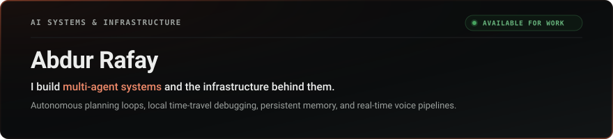

  

  
  &nbsp;
  
  &nbsp;
  
  &nbsp;
  

## About

I'm Abdur Rafay, an AI Engineer based in Islamabad. I design and ship multi-agent systems and agent infrastructure: autonomous planning loops, local time-travel debugging, persistent memory, and real-time voice pipelines. I own the CI/CD and cloud stack underneath them too.

Most AI work fails somewhere other than the prompt: in state drift across agents, in unobservable tool loops, in a blocking call that adds half a second to a phone conversation, or in the deploy that nobody automated. I work on that whole surface, not just the model call.

- Author of **Athar**, **Relay**, and **ai-cache** on PyPI.
- Focus: Multi-agent systems, local-first agent infrastructure, and real-time voice AI.
- Infrastructure ownership: CI/CD automation, Docker, AWS, and Google Cloud stacks.
- Engineering background across six international roles (formerly Member of Technical Staff at Lythe Labs).
- Undergraduate AI Researcher completing a BS in Artificial Intelligence at Bahria University (BUIC E-8).
- Available for freelance contracts and full-time engineering roles.

## Published on PyPI &amp; Core Systems

| Project | Type | Description | Stack | Links |
|:---|:---:|:---|:---|:---:|
| **Athar** | PyPI | Local-first, time-travel debugger and observability engine for multi-agent LLM systems with SQLite WAL, state mutation, and instantaneous fork &amp; replay. | Python, FastAPI, SQLite WAL, LangGraph | [Source](https://github.com/Abdur-Rafay-AR/athar) &middot; [PyPI](https://pypi.org/project/athar/) |
| **Relay** | PyPI | MCP server that audits Python voice-agent codebases for async mistakes and blocking calls that quietly add latency to a phone call via AST analysis. | Python, MCP, AST Analysis, asyncio | [Source](https://github.com/arclat-ai/relay-mcp) &middot; [PyPI](https://pypi.org/project/relay-arclat/) |
| **ai-cache** | PyPI | Transparent local caching of LLM responses across OpenAI, Anthropic, and Gemini via SQLite to cut latency and API token spend. | Python, SQLite, LLM APIs | [Source](https://github.com/Abdur-Rafay-AR/ai-cache) &middot; [PyPI](https://pypi.org/project/ai-cache/) |
| **Crucible** | OSS | Multi-agent framework that runs entirely on-machine: hybrid BM25 + embedding retrieval over SQLite, local models via Ollama, zero core dependencies. | Python, SQLite, Ollama, BM25 | [Source](https://github.com/Abdur-Rafay-AR/crucible) |
| **Voice Agent Starter Kit** | OSS | Complete real-time voice loop streaming ASR &rarr; LLM &rarr; TTS over WebSockets with client-side VAD, barge-in, and built-in latency telemetry. | FastAPI, WebSockets, Deepgram, Groq | [Source](https://github.com/lythelab/voice-agent-starter-kit) |
| **mcpie** | OSS | Security scanner for MCP servers in the shape of npm audit. Scans for tool poisoning, over-broad permissions, and credential exposure. | TypeScript, MCP, Static Analysis | [Source](https://github.com/arclat-ai/mcpie) |
| **Agent Testing Suite** | OSS | Interactive evaluation dashboard for multi-agent pipelines: instruments latency, token spend, and tool invocation frequency. | Python, LangChain, Streamlit | [Source](https://github.com/lythelab/agent-testing-suite) |
| **Long-Running Agent** | OSS | Autonomous agent built for weeks of continuous runtime: LLM planning loops, sandboxed execution, and resumable sessions. | Python, LangChain, FastAPI | [Source](https://github.com/lythelab/autonomous-agent) |

## Upstream Contributions

- **[arize-ai/phoenix](https://github.com/Arize-ai/phoenix)** (11.4k+ stars): Added the production `GET /v1/model_providers` REST endpoint with pagination, auth scoping, automated OpenAPI schema generation, and full pytest regression coverage.
- **[docling-project/docling-core](https://github.com/docling-project/docling-core)** (IBM): Exposed JSON serialization kwargs (`ensure_ascii`, `sort_keys`) in `save_as_json` with unit test suites covering non-ASCII encoding guarantees.

## Toolkit

  <b>Languages</b> 
  
  
  
  
  

  <b>AI, LLMs &amp; Agents</b> 
  
  
  
  
  
  
  
  

  <b>Backend &amp; Real-Time</b> 
  
  
  
  
  
  

  <b>Cloud, DevOps &amp; QA</b> 
  
  
  
  
  

## Credentials

<table>
  <tr>
    <td width="150" align="center">
      
    </td>
    <td>
      <h3>IBM AI Developer Professional Certificate</h3>
      
Demonstrated proficiency in building, training, and deploying AI models, generative AI integrations, and full-stack Python/Flask applications.

      <a href="https://www.credly.com/users/abdur-rafay.658ecb38" target="_blank">
        <b>Verify on Credly &rarr;</b>
      </a>
    </td>
  </tr>
</table>

- **AI Infrastructure &amp; Operations Fundamentals**: NVIDIA
- **Generative AI with Large Language Models**: AWS &amp; DeepLearning.AI
- **Supervised Machine Learning: Regression &amp; Classification**: Stanford &amp; DeepLearning.AI

## Activity

  
  &nbsp;&nbsp;&nbsp;&nbsp;
  

  <a href="https://abdur-rafay-ar.github.io/" target="_blank">Portfolio</a> &nbsp;&middot;&nbsp;
  <a href="https://linkedin.com/in/abdur-rafay-ar" target="_blank">LinkedIn</a> &nbsp;&middot;&nbsp;
  <a href="https://www.upwork.com/freelancers/~01e0e53ea3fc415198" target="_blank">Upwork</a> &nbsp;&middot;&nbsp;
  <a href="https://medium.com/@abdurrafay432007" target="_blank">Medium</a> &nbsp;&middot;&nbsp;
  <a href="https://abdur-rafay-ar.github.io/resume/" target="_blank">Résumé</a> &nbsp;&middot;&nbsp;
  <a href="mailto:abdurrafay.tech@gmail.com">Contact</a>

